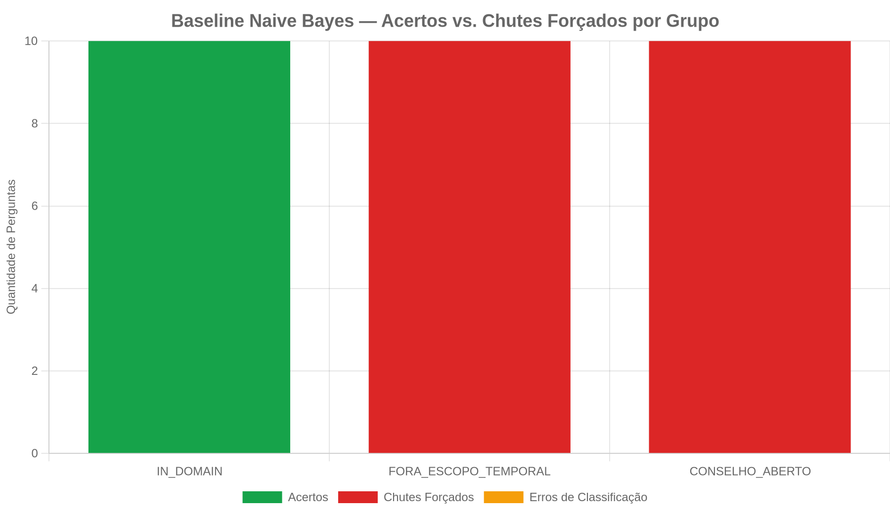
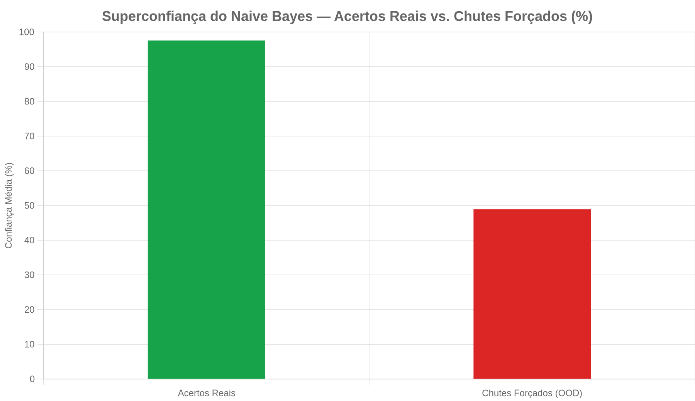

# Relatório de Benchmark Baseline ("Antes") — Bufunfa Naive Bayes

**Gerado em:** 2026-11-27T00:42:27.992Z  
**Modelo avaliado:** `model.json` v1.0.0 (9 classes, vocabulário de 515 tokens entre unigramas e bigramas)  
**Motor:** `classificarNaiveBayesPuro()` (inferência Multinomial Naive Bayes + Laplace Smoothing + Softmax, sem regras heurísticas ou travas de confiança)  
**Total de perguntas avaliadas:** 30 (10 `IN_DOMAIN`, 10 `FORA_ESCOPO_TEMPORAL`, 10 `CONSELHO_ABERTO`)

---

## 1. Resumo Executivo

Este benchmark registra a linha de base científica (**Baseline "Antes"**) do classificador clássico Naive Bayes do assistente financeiro **Bufunfa**, antes da introdução de travas de confiança (threshold / margem / OOV) e roteamento híbrido para LLM.

- **Acurácia Global (30 perguntas):** **33.3%** (10/30 acertos)
- **Acurácia In-Domain (10 perguntas cobertas pelo modelo):** **100.0%** (10/10 acertos)
- **Taxa de Chutes Forçados em Perguntas Fora de Domínio (OOD — 20 perguntas):** **100.0%** (20/20)
- **Erros de Classificação In-Domain:** 0
- **Latência Média de Inferência:** **0.4054 ms** (mín: 0.0484 ms | máx: 3.6197 ms)

### Diagnóstico da Hipótese do Mundo Fechado (*Closed-World Assumption*)

Por definição matemática, um classificador Multinomial Naive Bayes com normalização *Softmax* sempre atribui 100% da massa de probabilidade entre as classes conhecidas ($\sum_{c \in C} P(c \mid x) = 1$), assumindo que toda entrada pertence obrigatoriamente a uma das 9 intenções treinadas.

Como resultado direto observado neste baseline:
- Das **20 perguntas fora de domínio** (`FORA_ESCOPO_TEMPORAL` + `CONSELHO_ABERTO`), **20** resultaram em **`CHUTE_FORCADO`** — o modelo encaixou perguntas de fatura, metas, parcelas ou investimentos em intenções existentes sem conseguir sinalizar `FALLBACK`.
- Nos **Acertos Reais**, a confiança média foi de **97.6%** (margem média de **96.0 p.p.** e taxa OOV média de **25.1%**).
- Nos **Chutes Forçados**, a confiança média foi de **48.9%** (margem média de **30.8 p.p.** e taxa OOV média de **67.7%**).

Esses números evidenciam quantitativamente por que um limiar simples apenas de confiança sofre com superconfiança do *Softmax* em tokens fora do vocabulário, justificando a combinação de **confiança + margem entre top-1/top-2 + taxa OOV** no seletor híbrido futuro.

---

## 2. Métricas por Grupo

| Grupo | Total | Acertos | Chutes Forçados | Erros Classificação | Acurácia (%) | Confiança Média (%) | Margem Média (%) | Taxa OOV Média (%) | Latência Média |
| :--- | :---: | :---: | :---: | :---: | :---: | :---: | :---: | :---: | :---: |
| `IN_DOMAIN` | 10 | 10 | 0 | 0 | 100.0% | 97.6% | 96.0% | 25.1% | 0.5181 ms |
| `FORA_ESCOPO_TEMPORAL` | 10 | 0 | 10 | 0 | 0.0% | 52.0% | 34.1% | 59.8% | 0.6010 ms |
| `CONSELHO_ABERTO` | 10 | 0 | 10 | 0 | 0.0% | 45.9% | 27.5% | 75.7% | 0.0971 ms |

---

## 3. Comparativo: Acertos Reais vs. Chutes Forçados

| Categoria do Desfecho | Quantidade | Confiança Média (%) | Margem Média (%) | Taxa OOV Média (%) |
| :--- | :---: | :---: | :---: | :---: |
| **Acertos Reais (`ACERTO`)** | 10 | 97.6% | 96.0% | 25.1% |
| **Chutes Forçados (`CHUTE_FORCADO`)** | 20 | 48.9% | 30.8% | 67.7% |

### Gráficos Gerados

---

## 4. Tabela Completa das 30 Perguntas Avaliadas

| ID | Grupo | Pergunta | Esperada | Prevista (NB Puro) | Status | Confiança | Margem | Taxa OOV | Latência |
| :---: | :--- | :--- | :--- | :--- | :--- | :---: | :---: | :---: | :---: |
| 1 | `IN_DOMAIN` | qual meu saldo disponivel hoje nas contas? | `CONSULTAR_SALDO` | `CONSULTAR_SALDO` | **ACERTO** | 99.8% | 99.8% | 38.5% | 0.4974 ms |
| 2 | `IN_DOMAIN` | em qual area eu torrei mais dinheiro neste mes? | `ONDE_GASTEI_MAIS` | `ONDE_GASTEI_MAIS` | **ACERTO** | 89.3% | 81.4% | 41.2% | 0.0484 ms |
| 3 | `IN_DOMAIN` | qual foi a categoria com o menor gasto do mes? | `ONDE_GASTEI_MENOS` | `ONDE_GASTEI_MENOS` | **ACERTO** | 99.3% | 98.6% | 13.3% | 3.6197 ms |
| 4 | `IN_DOMAIN` | compara minhas despesas deste mes com o mes anterior | `COMPARAR_MES_ANTERIOR` | `COMPARAR_MES_ANTERIOR` | **ACERTO** | 99.6% | 99.3% | 6.7% | 0.2229 ms |
| 5 | `IN_DOMAIN` | quanto eu gastei com supermercado e alimentacao esse mes? | `GASTO_CATEGORIA` | `GASTO_CATEGORIA` | **ACERTO** | 99.2% | 99.0% | 33.3% | 0.1433 ms |
| 6 | `IN_DOMAIN` | qual foi o total de despesas que tive ate agora no mes? | `CONSULTAR_GASTOS` | `CONSULTAR_GASTOS` | **ACERTO** | 95.9% | 92.6% | 19.0% | 0.1443 ms |
| 7 | `IN_DOMAIN` | quanto de dinheiro entrou de receitas e salario esse mes? | `CONSULTAR_RECEITAS` | `CONSULTAR_RECEITAS` | **ACERTO** | 96.0% | 93.4% | 17.6% | 0.1405 ms |
| 8 | `IN_DOMAIN` | como anda a minha saude financeira neste mes? | `SAUDE_FINANCEIRA` | `SAUDE_FINANCEIRA` | **ACERTO** | 96.6% | 95.9% | 46.2% | 0.0957 ms |
| 9 | `IN_DOMAIN` | me mostra onde posso cortar gastos para economizar mais | `CORTAR_GASTOS` | `CORTAR_GASTOS` | **ACERTO** | 100.0% | 100.0% | 11.8% | 0.1250 ms |
| 10 | `IN_DOMAIN` | quanto gastei com uber e transporte este mes? | `GASTO_CATEGORIA` | `GASTO_CATEGORIA` | **ACERTO** | 99.9% | 99.8% | 23.1% | 0.1434 ms |
| 11 | `FORA_ESCOPO_TEMPORAL` | quanto gastei nos últimos 6 meses? | `FALLBACK` | `GASTO_CATEGORIA` | **CHUTE_FORCADO** | 92.2% | 88.6% | 44.4% | 2.5721 ms |
| 12 | `FORA_ESCOPO_TEMPORAL` | qual o valor da minha fatura do cartão de crédito? | `FALLBACK` | `CONSULTAR_GASTOS` | **CHUTE_FORCADO** | 21.2% | 3.9% | 58.8% | 0.1292 ms |
| 13 | `FORA_ESCOPO_TEMPORAL` | quanto falta para atingir minha meta de viagem na caixinha? | `FALLBACK` | `CONSULTAR_SALDO` | **CHUTE_FORCADO** | 51.9% | 25.8% | 73.7% | 2.6961 ms |
| 14 | `FORA_ESCOPO_TEMPORAL` | quanto gastei na semana passada? | `FALLBACK` | `GASTO_CATEGORIA` | **CHUTE_FORCADO** | 90.5% | 86.9% | 55.6% | 0.0873 ms |
| 15 | `FORA_ESCOPO_TEMPORAL` | qual foi o total de despesas no ano passado inteiro? | `FALLBACK` | `CONSULTAR_GASTOS` | **CHUTE_FORCADO** | 88.6% | 81.4% | 35.3% | 0.0944 ms |
| 16 | `FORA_ESCOPO_TEMPORAL` | que dia vence a fatura do meu cartão Nubank? | `FALLBACK` | `ONDE_GASTEI_MAIS` | **CHUTE_FORCADO** | 34.9% | 0.1% | 73.3% | 0.0916 ms |
| 17 | `FORA_ESCOPO_TEMPORAL` | quantas parcelas ainda faltam pagar do meu celular? | `FALLBACK` | `SAUDE_FINANCEIRA` | **CHUTE_FORCADO** | 31.7% | 15.8% | 73.3% | 0.0808 ms |
| 18 | `FORA_ESCOPO_TEMPORAL` | quais contas fixas vencem nos próximos 7 dias? | `FALLBACK` | `CONSULTAR_SALDO` | **CHUTE_FORCADO** | 28.1% | 5.8% | 76.9% | 0.0769 ms |
| 19 | `FORA_ESCOPO_TEMPORAL` | qual foi minha média mensal de gastos no último trimestre? | `FALLBACK` | `ONDE_GASTEI_MAIS` | **CHUTE_FORCADO** | 34.5% | 11.4% | 42.1% | 0.0948 ms |
| 20 | `FORA_ESCOPO_TEMPORAL` | quanto eu já guardei nas minhas caixinhas até hoje? | `FALLBACK` | `CONSULTAR_RECEITAS` | **CHUTE_FORCADO** | 46.3% | 21.0% | 64.7% | 0.0865 ms |
| 21 | `CONSELHO_ABERTO` | consigo comprar um notebook de 3000 reais parcelado em 10x? | `FALLBACK` | `CORTAR_GASTOS` | **CHUTE_FORCADO** | 25.9% | 7.3% | 84.2% | 0.1129 ms |
| 22 | `CONSELHO_ABERTO` | como faço para juntar mil reais até o fim do ano? | `FALLBACK` | `CORTAR_GASTOS` | **CHUTE_FORCADO** | 31.4% | 7.4% | 73.7% | 0.0925 ms |
| 23 | `CONSELHO_ABERTO` | vale a pena investir no Tesouro Selic ou deixar na poupança? | `FALLBACK` | `SAUDE_FINANCEIRA` | **CHUTE_FORCADO** | 36.7% | 9.4% | 78.9% | 0.0917 ms |
| 24 | `CONSELHO_ABERTO` | por que meus gastos subiram tanto ultimamente? | `FALLBACK` | `COMPARAR_MES_ANTERIOR` | **CHUTE_FORCADO** | 90.1% | 84.4% | 69.2% | 0.0742 ms |
| 25 | `CONSELHO_ABERTO` | qual é a melhor estratégia para quitar minhas dívidas do cartão? | `FALLBACK` | `CONSULTAR_RECEITAS` | **CHUTE_FORCADO** | 36.8% | 12.6% | 76.5% | 0.0879 ms |
| 26 | `CONSELHO_ABERTO` | quanto devo separar por mês para montar uma reserva de emergência? | `FALLBACK` | `CONSULTAR_RECEITAS` | **CHUTE_FORCADO** | 38.4% | 15.6% | 76.2% | 0.0949 ms |
| 27 | `CONSELHO_ABERTO` | é melhor pagar o aluguel à vista com desconto ou investir o dinheiro? | `FALLBACK` | `GASTO_CATEGORIA` | **CHUTE_FORCADO** | 33.4% | 13.1% | 76.5% | 0.0920 ms |
| 28 | `CONSELHO_ABERTO` | me ajuda a montar um orçamento mensal realista para minha família | `FALLBACK` | `CORTAR_GASTOS` | **CHUTE_FORCADO** | 54.6% | 39.1% | 73.7% | 0.1079 ms |
| 29 | `CONSELHO_ABERTO` | como organizar minhas finanças usando a regra 50 30 20 na prática? | `FALLBACK` | `SAUDE_FINANCEIRA` | **CHUTE_FORCADO** | 81.3% | 72.8% | 76.2% | 0.1106 ms |
| 30 | `CONSELHO_ABERTO` | se eu economizar 300 reais por mês, quanto terei em 2 anos? | `FALLBACK` | `GASTO_CATEGORIA` | **CHUTE_FORCADO** | 30.5% | 13.0% | 71.4% | 0.1063 ms |
