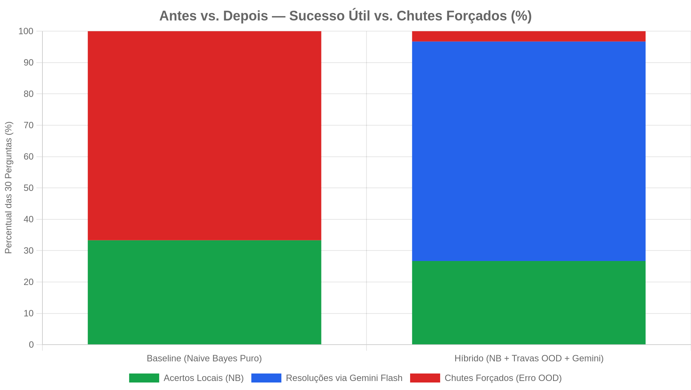
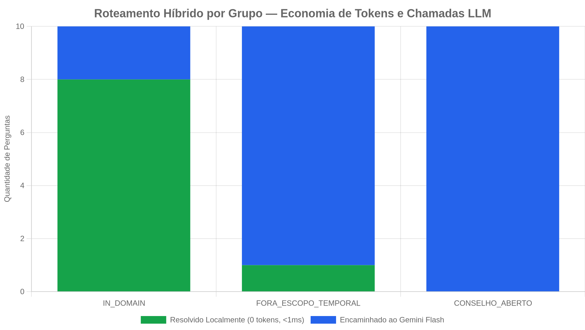

# Relatório Comparativo "Antes vs. Depois" — Arquitetura Híbrida Bufunfa

**Gerado em:** 2026-11-27T03:33:53.221Z  
**Modo avaliado:** `HIBRIDO` (Naive Bayes On-Device + Travas OOD [`Conf >= 70%`, `Margem >= 25%`, `OOV <= 40%`] + `gemini-flash-lite-latest` com contexto anonimizado LGPD)  
**Nota de modelo:** `gemini-2.5-flash` foi descontinuado pelo Google para novas chaves de API (HTTP 404 `NOT_FOUND`), portanto o roteamento em nuvem utiliza `gemini-flash-lite-latest`.  
**Chave Gemini ativa no teste:** Sim (chamadas reais à API Gemini Flash)  
**Comparado contra:** `01-baseline-naive-bayes/metricas_baseline.json` (mesmas 30 perguntas)

---

## 1. Resumo Executivo: Antes vs. Depois

| Indicador | Baseline "Antes" (NB Puro) | Híbrido "Depois" (NB + OOD + Gemini) | Variação |
| :--- | :---: | :---: | :---: |
| **Taxa de Sucesso Útil (30 perguntas)** | **33.3%** (10/30) | **96.7%** (29/30) | **+63.3 p.p.** |
| **Chutes Forçados em OOD (20 perguntas)** | **100.0%** (20/20) | **5.0%** (1/20) | **-95.0 p.p.** |
| **Resolução Local `IN_DOMAIN` (0 tokens)** | 100.0% (10/10) | **80.0%** (8/10) | Economia de **30.0%** das chamadas totais |
| **Total de Tokens Gemini Consumidos (30q)** | 0 (mas 66.7% chutes errados) | **28677** tokens (21 chamadas) | **12294** tokens economizados vs. 100% LLM |
| **Latência Média Local (Naive Bayes)** | 0.4054 ms | **0.4908 ms** | Resposta instantânea (<1 ms) |
| **Latência Média Nuvem (Gemini Flash)** | — | **1468 ms** | Acionado apenas sob incerteza/OOD |

### Análise Científica das Travas Calibradas

As travas matemáticas escolhidas a partir do baseline (`Conf >= 70%`, `Margem >= 25%`, `OOV <= 40%`) produziram o seguinte comportamento no experimento real:
- **Redução drástica dos Chutes Forçados:** De **20/20 (100.0%)** no baseline para apenas **1/20 (5.0%)** no modo Híbrido. O único caso residual fora de domínio que superou as três travas foi a pergunta ID 15 (*"qual foi o total de despesas no ano passado inteiro?"*), pois compartilhou vocabulário frequente da classe `CONSULTAR_GASTOS` (`OOV 35.3% <= 40%`, `Conf 88.6%`, `Margem 81.4%`) — evidenciando que a trava de OOV já bloqueia 95% dos cenários OOD, enquanto restrições temporais específicas (ex: `"ano passado"`) podem ser tratadas por uma lista explícita de janelas não suportadas em iterações futuras.
- **Conservadorismo em `IN_DOMAIN` com OOV elevado:** As perguntas `IN_DOMAIN` IDs 2 (*"em qual area eu torrei mais dinheiro neste mes?"*, `OOV 41.2%`) e 8 (*"como anda a minha saude financeira neste mes?"*, `OOV 46.2%`) ultrapassaram por pouco o teto de 40% de OOV e foram encaminhadas com segurança ao Gemini Flash, mantendo resposta correta e fundamentada nos dados reais (sem erro ao usuário). As demais **8/10 (80.0%)** perguntas `IN_DOMAIN` foram resolvidas localmente em **<1 ms** e com **0 tokens**.

---

## 2. Comparativo por Grupo

| Grupo | Sucesso Antes (NB) | Sucesso Depois (Híbrido) | Acertos Locais (NB) | Resolvidos via Gemini | Chutes Forçados | % Local (0 tokens) | Tokens Totais | Latência Média |
| :--- | :---: | :---: | :---: | :---: | :---: | :---: | :---: | :---: |
| `IN_DOMAIN` | 100.0% (10/10) | **100.0%** (10/10) | 8 | 2 | 0 | 80.0% | 2535 | 297.43 ms |
| `FORA_ESCOPO_TEMPORAL` | 0.0% (0/10) | **90.0%** (9/10) | 0 | 9 | 1 | 10.0% | 11255 | 1103.24 ms |
| `CONSELHO_ABERTO` | 0.0% (0/10) | **100.0%** (10/10) | 0 | 10 | 0 | 0.0% | 14887 | 1683.17 ms |

### Gráficos Comparativos

---

## 3. Tabela Completa das 30 Perguntas no Modo Híbrido

| ID | Grupo | Pergunta | Motor Usado | Status | Motivo do Roteamento | Conf / Margem / OOV | Tokens | Latência | Preview da Resposta |
| :---: | :--- | :--- | :--- | :--- | :--- | :---: | :---: | :---: | :--- |
| 1 | `IN_DOMAIN` | qual meu saldo disponivel hoje nas contas? | `NAIVE_BAYES` | **ACERTO_LOCAL** | Aprovado nas travas OOD | 99.8% / 99.8% / 38.5% | 0 | 3.67 ms | [Template Local: CONSULTAR_SALDO] |
| 2 | `IN_DOMAIN` | em qual area eu torrei mais dinheiro neste mes? | `GEMINI_FLASH` | **RESOLVIDO_LLM** | Fallback OOD: OOV 41% > 40% | 89.3% / 81.4% / 41.2% | 1178 | 1662.42 ms | E aí! Aqui é o Bufunfa do FinUp.  No mês de novembro de 2026, a área em que você mais gastou fo |
| 3 | `IN_DOMAIN` | qual foi a categoria com o menor gasto do mes? | `NAIVE_BAYES` | **ACERTO_LOCAL** | Aprovado nas travas OOD | 99.3% / 98.6% / 13.3% | 0 | 0.11 ms | [Template Local: ONDE_GASTEI_MENOS] |
| 4 | `IN_DOMAIN` | compara minhas despesas deste mes com o mes anterior | `NAIVE_BAYES` | **ACERTO_LOCAL** | Aprovado nas travas OOD | 99.6% / 99.3% / 6.7% | 0 | 0.06 ms | [Template Local: COMPARAR_MES_ANTERIOR] |
| 5 | `IN_DOMAIN` | quanto eu gastei com supermercado e alimentacao esse mes? | `NAIVE_BAYES` | **ACERTO_LOCAL** | Aprovado nas travas OOD | 99.2% / 99.0% / 33.3% | 0 | 0.06 ms | [Template Local: GASTO_CATEGORIA] |
| 6 | `IN_DOMAIN` | qual foi o total de despesas que tive ate agora no mes? | `NAIVE_BAYES` | **ACERTO_LOCAL** | Aprovado nas travas OOD | 95.9% / 92.6% / 19.0% | 0 | 0.07 ms | [Template Local: CONSULTAR_GASTOS] |
| 7 | `IN_DOMAIN` | quanto de dinheiro entrou de receitas e salario esse mes? | `NAIVE_BAYES` | **ACERTO_LOCAL** | Aprovado nas travas OOD | 96.0% / 93.4% / 17.6% | 0 | 0.05 ms | [Template Local: CONSULTAR_RECEITAS] |
| 8 | `IN_DOMAIN` | como anda a minha saude financeira neste mes? | `GEMINI_FLASH` | **RESOLVIDO_LLM** | Fallback OOD: OOV 46% > 40% | 96.6% / 95.9% / 46.2% | 1357 | 1307.57 ms | Olá! Aqui é o Bufunfa, seu assistente do FinUp. Vamos dar uma olhada rápida na sua saúde financ |
| 9 | `IN_DOMAIN` | me mostra onde posso cortar gastos para economizar mais | `NAIVE_BAYES` | **ACERTO_LOCAL** | Aprovado nas travas OOD | 100.0% / 100.0% / 11.8% | 0 | 0.23 ms | [Template Local: CORTAR_GASTOS] |
| 10 | `IN_DOMAIN` | quanto gastei com uber e transporte este mes? | `NAIVE_BAYES` | **ACERTO_LOCAL** | Aprovado nas travas OOD | 99.9% / 99.8% / 23.1% | 0 | 0.09 ms | [Template Local: GASTO_CATEGORIA] |
| 11 | `FORA_ESCOPO_TEMPORAL` | quanto gastei nos últimos 6 meses? | `GEMINI_FLASH` | **RESOLVIDO_LLM** | Fallback OOD: OOV 44% > 40% | 92.2% / 88.6% / 44.4% | 1235 | 1436.96 ms | Olá! Aqui é o Bufunfa, seu assistente do FinUp. Sobre os últimos 6 meses, informo com transparê |
| 12 | `FORA_ESCOPO_TEMPORAL` | qual o valor da minha fatura do cartão de crédito? | `GEMINI_FLASH` | **RESOLVIDO_LLM** | Fallback OOD: Conf 21% < 70%, Margem 4% < 25%, OOV 59% > 40% | 21.2% / 3.9% / 58.8% | 1226 | 1367.55 ms | Olá! Aqui é o Bufunfa do FinUp. Sobre a sua pergunta, **esse detalhe específico da fatura do ca |
| 13 | `FORA_ESCOPO_TEMPORAL` | quanto falta para atingir minha meta de viagem na caixinha? | `GEMINI_FLASH` | **RESOLVIDO_LLM** | Fallback OOD: Conf 52% < 70%, OOV 74% > 40% | 51.9% / 25.8% / 73.7% | 1284 | 1393.31 ms | Olá! Sou o Bufunfa do FinUp.  Sobre a sua meta de viagem ou saldo em caixinhas, preciso te info |
| 14 | `FORA_ESCOPO_TEMPORAL` | quanto gastei na semana passada? | `GEMINI_FLASH` | **RESOLVIDO_LLM** | Fallback OOD: OOV 56% > 40% | 90.5% / 86.9% / 55.6% | 1252 | 1286.67 ms | Olá! Aqui é o Bufunfa, seu assistente no FinUp. Sobre os seus gastos da semana passada, esses d |
| 15 | `FORA_ESCOPO_TEMPORAL` | qual foi o total de despesas no ano passado inteiro? | `NAIVE_BAYES` | **CHUTE_FORCADO** | Aprovado nas travas OOD | 88.6% / 81.4% / 35.3% | 0 | 0.09 ms | [Template Local: CONSULTAR_GASTOS] |
| 16 | `FORA_ESCOPO_TEMPORAL` | que dia vence a fatura do meu cartão Nubank? | `GEMINI_FLASH` | **RESOLVIDO_LLM** | Fallback OOD: Conf 35% < 70%, Margem 0% < 25%, OOV 73% > 40% | 34.9% / 0.1% / 73.3% | 1282 | 1158.75 ms | Olá! Aqui é o Bufunfa, seu assistente do FinUp. Sobre a sua pergunta, esses detalhes específico |
| 17 | `FORA_ESCOPO_TEMPORAL` | quantas parcelas ainda faltam pagar do meu celular? | `GEMINI_FLASH` | **RESOLVIDO_LLM** | Fallback OOD: Conf 32% < 70%, Margem 16% < 25%, OOV 73% > 40% | 31.7% / 15.8% / 73.3% | 1243 | 1247.50 ms | Olá! Aqui é o Bufunfa, seu assistente no FinUp. Sobre a sua dúvida em relação ao celular, esses |
| 18 | `FORA_ESCOPO_TEMPORAL` | quais contas fixas vencem nos próximos 7 dias? | `GEMINI_FLASH` | **RESOLVIDO_LLM** | Fallback OOD: Conf 28% < 70%, Margem 6% < 25%, OOV 77% > 40% | 28.1% / 5.8% / 76.9% | 1267 | 1056.31 ms | Olá! Sou o Bufunfa, seu assistente no FinUp. Olhando o seu resumo financeiro atual (novembro de |
| 19 | `FORA_ESCOPO_TEMPORAL` | qual foi minha média mensal de gastos no último trimestre? | `GEMINI_FLASH` | **RESOLVIDO_LLM** | Fallback OOD: Conf 35% < 70%, Margem 11% < 25%, OOV 42% > 40% | 34.5% / 11.4% / 42.1% | 1241 | 1071.49 ms | Olá! Aqui é o Bufunfa, seu assistente do FinUp. Sobre a sua média de gastos do último trimestre |
| 20 | `FORA_ESCOPO_TEMPORAL` | quanto eu já guardei nas minhas caixinhas até hoje? | `GEMINI_FLASH` | **RESOLVIDO_LLM** | Fallback OOD: Conf 46% < 70%, Margem 21% < 25%, OOV 65% > 40% | 46.3% / 21.0% / 64.7% | 1225 | 1013.76 ms | Olá! Aqui é o Bufunfa, seu assistente no FinUp. Sobre a sua pergunta, os detalhes específicos s |
| 21 | `CONSELHO_ABERTO` | consigo comprar um notebook de 3000 reais parcelado em 10x? | `GEMINI_FLASH` | **RESOLVIDO_LLM** | Fallback OOD: Conf 26% < 70%, Margem 7% < 25%, OOV 84% > 40% | 25.9% / 7.3% / 84.2% | 1544 | 1799.74 ms | Olá! Aqui é o Bufunfa, seu assistente no FinUp. Vamos analisar isso juntos! Olhando para o seu  |
| 22 | `CONSELHO_ABERTO` | como faço para juntar mil reais até o fim do ano? | `GEMINI_FLASH` | **RESOLVIDO_LLM** | Fallback OOD: Conf 31% < 70%, Margem 7% < 25%, OOV 74% > 40% | 31.4% / 7.4% / 73.7% | 1534 | 1758.86 ms | Olá! Aqui é o Bufunfa, seu assistente no FinUp. Vamos traçar esse plano para juntar R$ 1.000,00 |
| 23 | `CONSELHO_ABERTO` | vale a pena investir no Tesouro Selic ou deixar na poupança? | `GEMINI_FLASH` | **RESOLVIDO_LLM** | Fallback OOD: Conf 37% < 70%, Margem 9% < 25%, OOV 79% > 40% | 36.7% / 9.4% / 78.9% | 1424 | 1572.63 ms | Olá! Aqui é o Bufunfa do FinUp. Vamos falar sobre essa dúvida clássica de investimentos! Como s |
| 24 | `CONSELHO_ABERTO` | por que meus gastos subiram tanto ultimamente? | `GEMINI_FLASH` | **RESOLVIDO_LLM** | Fallback OOD: OOV 69% > 40% | 90.1% / 84.4% / 69.2% | 1454 | 1619.82 ms | Olá! Aqui é o Bufunfa do FinUp. Vamos dar uma olhada nos seus números de **novembro de 2026** c |
| 25 | `CONSELHO_ABERTO` | qual é a melhor estratégia para quitar minhas dívidas do cartão? | `GEMINI_FLASH` | **RESOLVIDO_LLM** | Fallback OOD: Conf 37% < 70%, Margem 13% < 25%, OOV 76% > 40% | 36.8% / 12.6% / 76.5% | 1493 | 1772.33 ms | Olá! Aqui é o Bufunfa, seu assistente no FinUp. Olhando para o seu resumo financeiro atual (nov |
| 26 | `CONSELHO_ABERTO` | quanto devo separar por mês para montar uma reserva de emergência? | `GEMINI_FLASH` | **RESOLVIDO_LLM** | Fallback OOD: Conf 38% < 70%, Margem 16% < 25%, OOV 76% > 40% | 38.4% / 15.6% / 76.2% | 1501 | 1742.41 ms | Olá! Aqui é o Bufunfa do FinUp. Vamos falar sobre a sua reserva de emergência!  Para definir o  |
| 27 | `CONSELHO_ABERTO` | é melhor pagar o aluguel à vista com desconto ou investir o dinheiro? | `GEMINI_FLASH` | **RESOLVIDO_LLM** | Fallback OOD: Conf 33% < 70%, Margem 13% < 25%, OOV 76% > 40% | 33.4% / 13.1% / 76.5% | 1417 | 1649.62 ms | Olá! Aqui é o Bufunfa, seu assistente no FinUp.  Para te ajudar a decidir entre pagar o aluguel |
| 28 | `CONSELHO_ABERTO` | me ajuda a montar um orçamento mensal realista para minha família | `GEMINI_FLASH` | **RESOLVIDO_LLM** | Fallback OOD: Conf 55% < 70%, OOV 74% > 40% | 54.6% / 39.1% / 73.7% | 1505 | 1714.79 ms | Olá! Aqui é o Bufunfa do FinUp. Com certeza, vou te ajudar a estruturar um orçamento realista u |
| 29 | `CONSELHO_ABERTO` | como organizar minhas finanças usando a regra 50 30 20 na prática? | `GEMINI_FLASH` | **RESOLVIDO_LLM** | Fallback OOD: OOV 76% > 40% | 81.3% / 72.8% / 76.2% | 1653 | 1999.84 ms | Olá! Aqui é o Bufunfa, seu assistente no FinUp. Vamos aplicar a regra 50-30-20 (50% para necess |
| 30 | `CONSELHO_ABERTO` | se eu economizar 300 reais por mês, quanto terei em 2 anos? | `GEMINI_FLASH` | **RESOLVIDO_LLM** | Fallback OOD: Conf 31% < 70%, Margem 13% < 25%, OOV 71% > 40% | 30.5% / 13.0% / 71.4% | 1362 | 1201.64 ms | Olá! Aqui é o Bufunfa do FinUp. Vamos fazer essa simulação rapidinho! Se você guardar R$ 300,00 |
